#  Shade


[](LICENSE)

**Shade** is a real-time call assistant for Windows. It sits in the system
tray, listens to your microphone and your computer's audio during a call,
keeps a live English transcript, and streams a short answer you can say out
loud within seconds of being asked a question — including tasks shown on the
other side's screen.

> **Status:** alpha. Everything below is implemented and covered by tests;
> real-call behavior with each provider is still being measured.

## Screenshots

**Hint window** — the current hint on top (say the first lines out loud);
below it, tabs with the live **Transcript** and the **History** of earlier
hints. The status line shows the trigger, the model and the session cost.
It has the program icon and the usual minimize, maximize and close buttons,
but no taskbar button: minimize and close send it to the tray, and a click on
the tray icon (or **Show**) brings it back. **Day** or **Night** theme in
Settings → Display.

<table>
  <tr>
    <td align="center">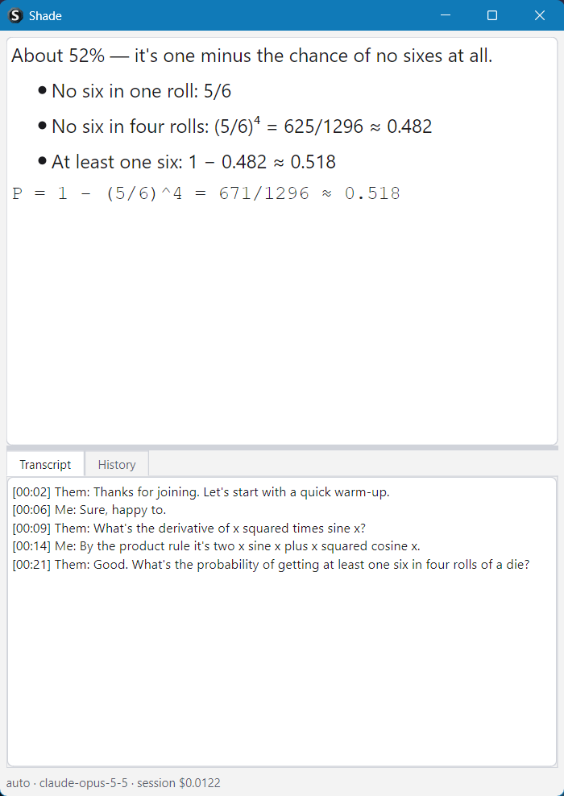</td>
    <td align="center">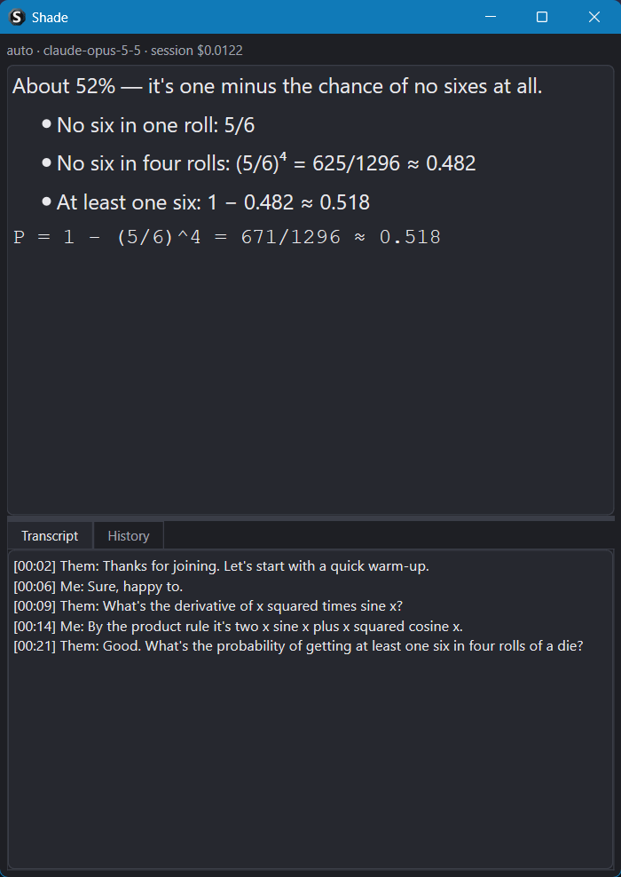</td>
  </tr>
  <tr>
    <td align="center"><b>Window — Day theme</b></td>
    <td align="center"><b>Window — Night theme</b></td>
  </tr>
</table>

**Overlay** — the same hint on a semi-transparent layer over the call, with
the last three transcript lines. Hidden from screen sharing. Background
color, text color and background opacity are set in Settings → Display;
the text itself stays fully opaque.

<table>
  <tr>
    <td align="center">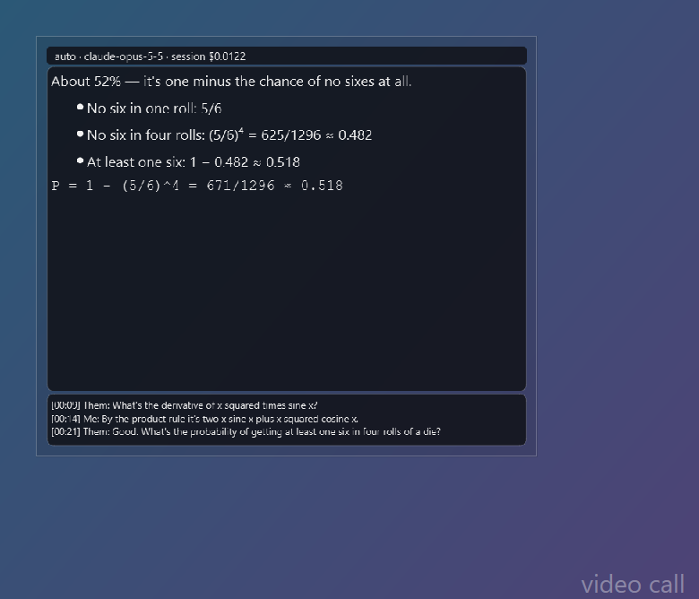</td>
    <td align="center">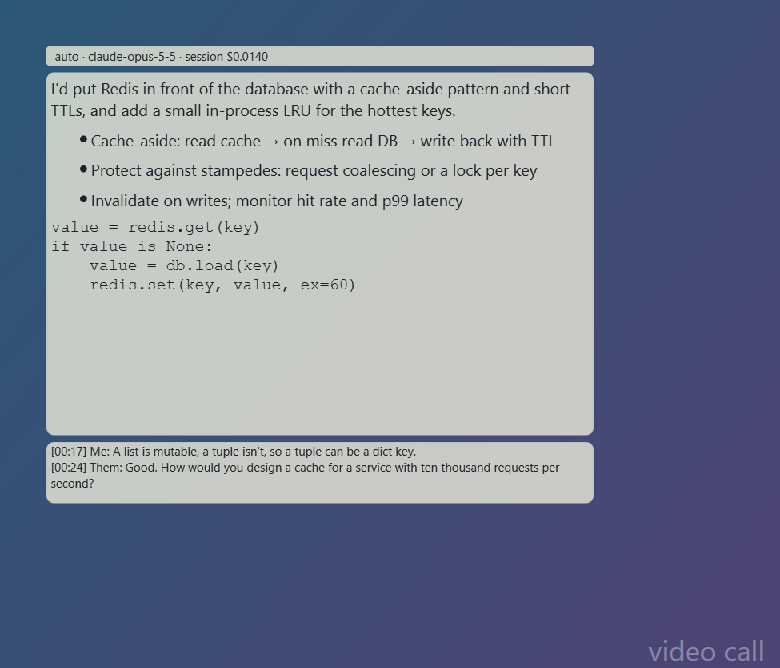</td>
  </tr>
  <tr>
    <td align="center"><b>Overlay — dark background, light text</b></td>
    <td align="center"><b>Overlay — light background, dark text</b></td>
  </tr>
</table>

**Tray menu and settings** — Shade lives in the system tray (the purple
**S**). Right-click it for the menu; **Settings…** has four tabs.

<p>
  
  &nbsp;
  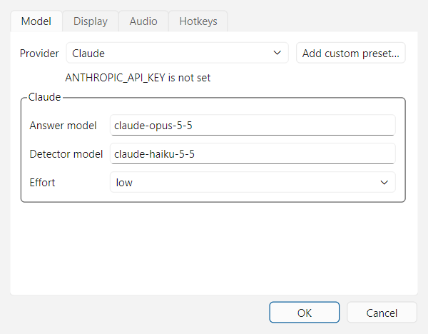
</p>
<p>
  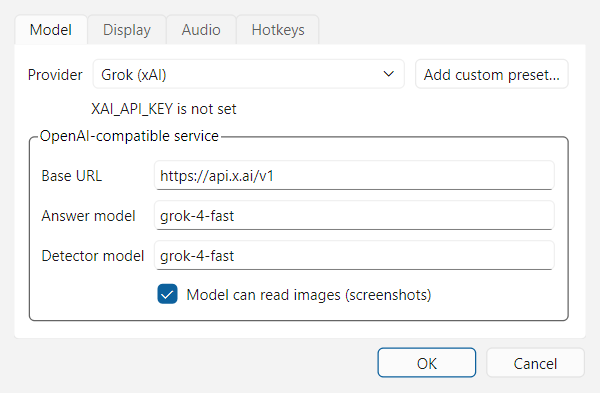
  &nbsp;
  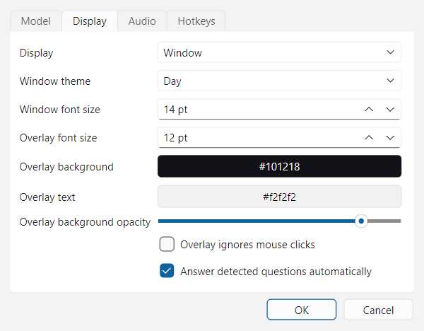
</p>
<p>
  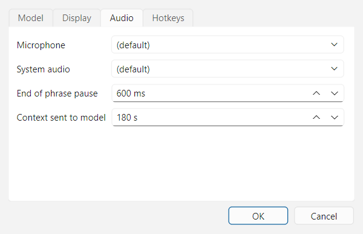
  &nbsp;
  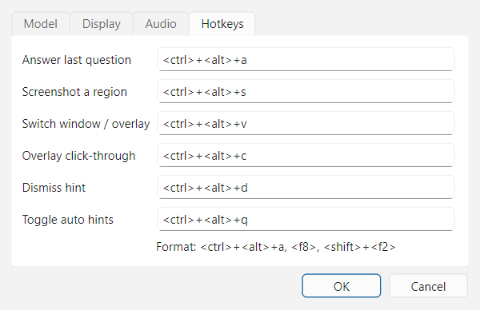
</p>

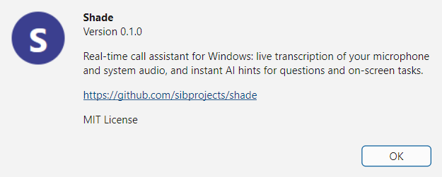

## At a glance

- **Use cases:** interviews, presentations, work calls with tricky
  questions. Anything in English where a fast, well-informed answer matters.
- **Two audio sources:** your microphone is labeled *Me*, system audio
  (Zoom, Teams, Meet, any app) is *Them*. No speaker diarization: the label
  comes from the source.
- **Speech-to-text:** runs locally on the GPU with faster-whisper
  (`distil-large-v3`, float16). Silero VAD cuts speech into utterances on a
  ~600 ms pause. Nothing is sent to the cloud for transcription.
- **Three triggers:**
  - **Auto:** a small, fast model checks each *Them* utterance for a question
    or a task, including indirect ones like "walk us through…".
  - **Hotkey:** answer the last question asked.
  - **Screenshot:** drag a rectangle over any screen, and the image is solved
    together with the recent conversation.
- **Call profiles:** before each call you pick a Markdown file from
  `profiles/` with your skills and what the call is about. It becomes the
  model's system prompt.
- **Models:** Claude, OpenAI, Grok (xAI), Groq, DeepSeek, Gemini, any other
  OpenAI-compatible service, or a local model through Ollama or LM Studio.
  You choose in Settings.
- **Hint format:** 1–3 lines you can say right away, then up to 4 short
  bullets, then code in one block if the task needs it. Hints stream token by
  token.
- **Display:** a normal window for a second monitor, or a semi-transparent
  always-on-top overlay with adjustable opacity and click-through.
- **Hidden from screen sharing:** every Shade window uses
  `SetWindowDisplayAffinity(WDA_EXCLUDEFROMCAPTURE)`, so it is not in your
  shared screen or in recordings.
- **Session notes:** `sessions/<date>_<profile>/` gets `transcript.md`,
  `hints.md` (question, answer, model, tokens, cost) and screenshots. Files
  are appended and flushed on every line, so a crash loses nothing.
- **Cost:** a running per-session cost counter is shown in the UI and
  written next to every hint. There is no hard cap.

## How it works

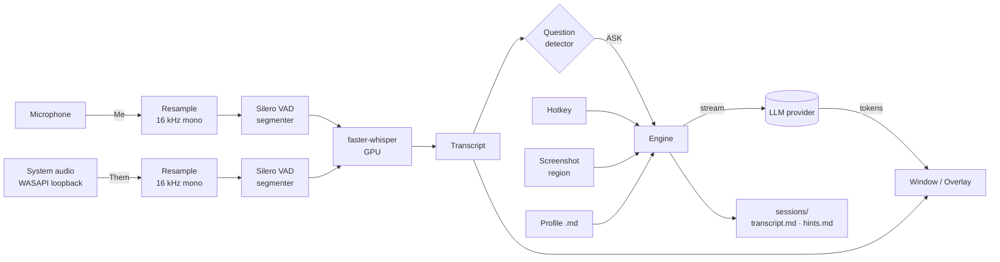

**Latency budget** (target: first words within 2–3 s after *Them* stops
talking):

| Stage | Budget |
|---|---|
| End-of-utterance pause (VAD) | ~0.6 s |
| Speech-to-text on the GPU | ≤ 0.5 s |
| Question detection (fast model) | ~0.3–0.5 s |
| Model time to first token | ~0.5–1.5 s |

**When questions collide:** a new hotkey or screenshot request cancels any
hint that is still streaming. A new auto-detected question replaces an
older auto hint, but never interrupts one you asked for. Cancelled hints are
still saved, marked *(cancelled)*.

**When something fails:** a missing API key, a provider outage or a stopped
local server shows a short message in the hint area. Transcription keeps
running. If the microphone or system audio device disappears, the other
source keeps working.

## Providers

| Provider | Key variable | Images | Notes |
|---|---|---|---|
| Claude | `ANTHROPIC_API_KEY` | yes | default; answers on Opus 5.5 (low effort), detection on Haiku 5.5 |
| OpenAI | `OPENAI_API_KEY` | yes | |
| Grok (xAI) | `XAI_API_KEY` | yes | OpenAI-compatible |
| Groq | `GROQ_API_KEY` | model-dependent | very low latency |
| DeepSeek | `DEEPSEEK_API_KEY` | no | |
| Gemini | `GEMINI_API_KEY` | yes | OpenAI-compatible endpoint |
| Local | — | model-dependent | Ollama / LM Studio on this PC |

Keys are read from environment variables only. They are never written to
settings, logs or session files. Model names, base URLs and image support are
editable per provider, and you can add your own OpenAI-compatible preset.

**Local model on the same GPU:** with the local provider, speech-to-text
switches to a lighter setup (`small.en`, int8) to leave VRAM for the model,
and Shade warns when GPU memory is above 90%. Small quantized models
(~3–8B, Q4) are recommended; for screenshots, use one with vision.

## Hotkeys

| Action | Keys |
|---|---|
| Answer the last question | `Ctrl+Alt+A` |
| Screenshot a region | `Ctrl+Alt+S` |
| Switch window / overlay | `Ctrl+Alt+V` |
| Toggle overlay click-through | `Ctrl+Alt+C` |
| Dismiss the current hint | `Ctrl+Alt+D` |
| Toggle auto hints | `Ctrl+Alt+Q` |

All hotkeys are global (they work while another app has focus) and can be
changed in Settings. In the screenshot selector, Esc or a right click cancels.

## Project layout

```
src/shade/
  audio/        capture (mic, loopback), resampling, VAD segmenter
  llm/          Claude and OpenAI-compatible providers
  ui/           tray app, window, overlay, hotkeys, screenshot, settings
  stt.py        faster-whisper worker
  transcript.py rolling transcript
  detect.py     question detector
  engine.py     orchestration, cancel/replace
  session.py    crash-safe session files
profiles/       call profiles (Markdown)
sessions/       saved calls (git-ignored)
```

## Requirements

- Windows 10 2004+ / Windows 11
- Python 3.11 and [uv](https://docs.astral.sh/uv/)
- NVIDIA GPU with CUDA 12 support (tested target: RTX 3070 Ti, 8 GB)
- Headphones are recommended, so the microphone doesn't pick up the other side

## Setup

```powershell
git clone https://github.com/sibprojects/shade.git
cd shade
uv sync
$env:ANTHROPIC_API_KEY = "sk-ant-..."   # or the key for the provider you use
uv run python -m shade
```

The first start downloads the speech model (`distil-large-v3`, ~1.5 GB) to
the Hugging Face cache. A tray icon appears; when its tooltip says
**ready**, right-click it → **Start session** → pick a profile.

- **Profiles:** put your own `.md` files in `profiles/` (see
  `profiles/example.md`) or use **Browse…**.
- **Settings:** tray → **Settings…** (provider, models, display, audio
  devices, hotkeys). Saved to `settings.toml` next to the app, without keys.
- **Sessions:** tray → **Open sessions folder**.
- **Local model:** run Ollama (`ollama pull qwen2.5vl:7b`) or LM Studio,
  choose **Local model** in Settings and check the base URL
  (`http://localhost:11434/v1` for Ollama, `http://localhost:1234/v1` for
  LM Studio).
- **Check audio only:** `uv run python scripts/smoke_audio.py` prints a live
  *Me*/*Them* transcript with recognition time per phrase.

## Measured

On an RTX 3070 Ti (8 GB), Windows 11:

| What | Result |
|---|---|
| Speech-to-text, `distil-large-v3` float16, 7.8 s phrase | 0.25 s |
| Speech-to-text, `small.en` int8 (local-model mode), same phrase | 0.15 s |
| End of speech → first hint word, excluding model time | ~0.8 s |

Time to first token for each provider will be added after real calls.

## Development

- **Environment:** uv, Python 3.11.
- **Tests:** `uv run pytest`. The core (transcript, segmenter, detector,
  engine, providers, session files) is tested with fakes; UI widgets with
  pytest-qt. Audio, GPU, hotkeys and screen capture get scripted manual checks.
- **Docs:** [design](docs/superpowers/specs/2026-11-09-shade-design.md) ·
  [implementation plan](docs/superpowers/plans/2026-11-09-shade.md)

## A note on consent

Shade transcribes other people's speech. Depending on where you and they are,
recording or transcribing a conversation may require their consent. Making
sure you have it is your responsibility.

## License

[MIT](LICENSE)
